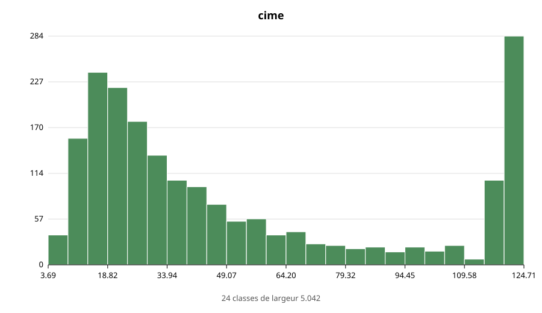
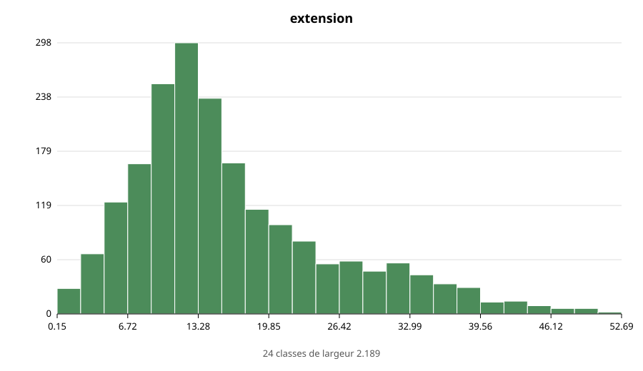
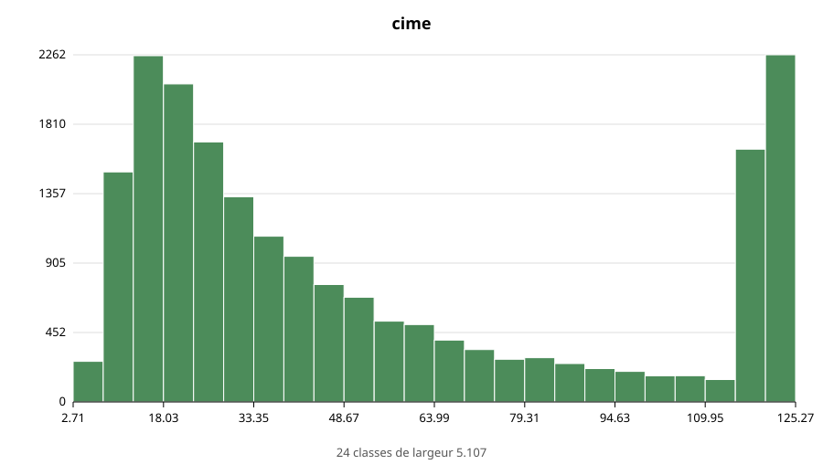
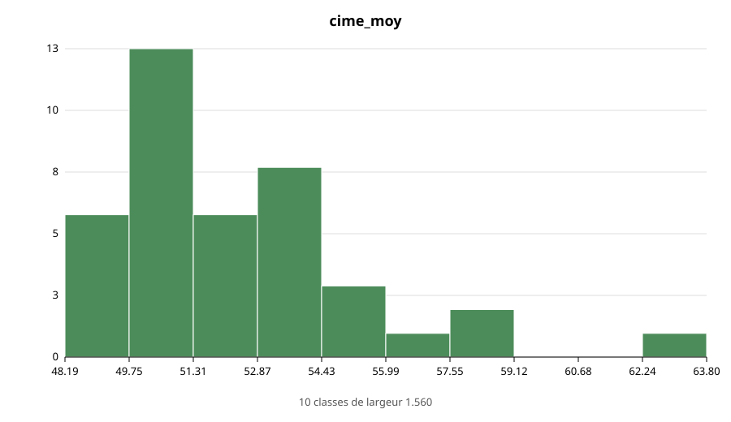
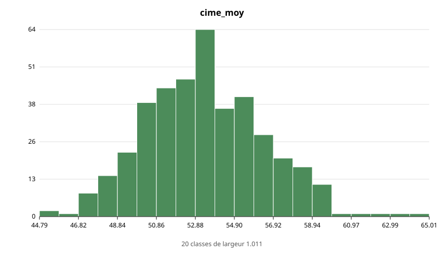
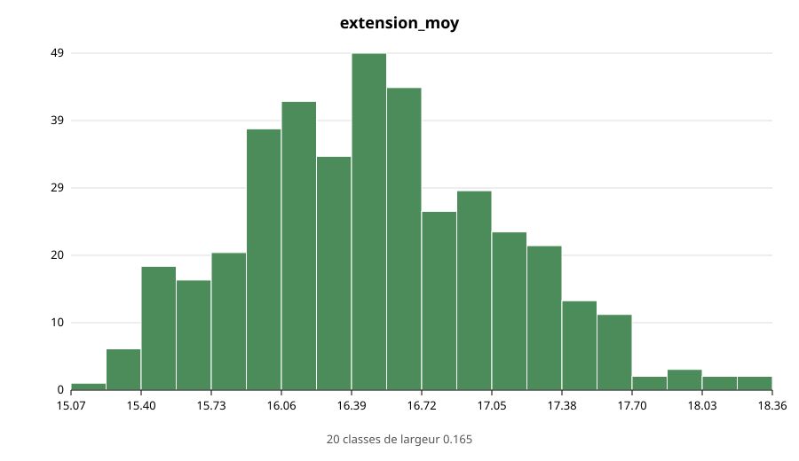
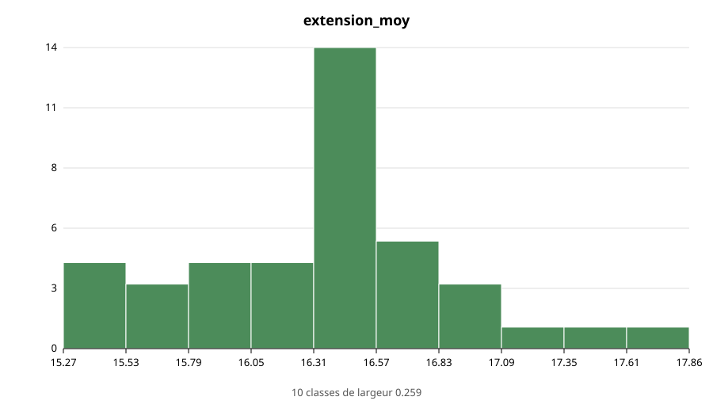

# TI301 - La forêt et la lumière : réponses aux questions

Équipe SC3 : Bui, Dalal, Hamdallah

Les histogrammes cités sont dans le dossier [rapport/histogrammes](rapport/histogrammes).

---

## Partie 1

### Étape 2 : les 8 premières saisons des deux animations sont identiques. Pourquoi ?

Les deux animations sont faites avec la même graine (3). `createTree` appelle `randomInit(3)`, donc les deux simulations utilisent exactement la même suite de nombres pseudo-aléatoires.

`growTree` traite les saisons dans l'ordre, de 1 à S, et à chaque saison les tirages faits ne dépendent que de l'état de l'arbre à la fin de la saison précédente (la file des bourgeons) et de la suite des nombres. Rien dans les saisons 1 à 8 ne dépend du nombre total de saisons S : avec S = 8 ou S = 15, les mêmes tirages sont faits dans le même ordre pendant les 8 premières saisons, et on obtient le même arbre. Avec S = 15, la simulation continue simplement la suite pour les saisons 9 à 15.

C'est aussi ce qui permet de retrouver `arbre_moyen.txt` (graine 3, 8 saisons) dans les 8 premières saisons de l'arbre à 15 saisons.

---

## Partie 2

### Étape 1 : pour la cime, on peut se contenter des bourgeons ; pour l'extension, il faut regarder tous les rameaux. Pourquoi ?

Un fils part de l'extrémité de son parent avec une direction comprise entre -80° et +80° par rapport à la verticale :

- en altitude : y_fils = y_parent + L cos(dir). Comme |dir| <= 80°, cos(dir) > 0, donc un fils est toujours strictement plus haut que son parent ;
- en position x : x_fils = x_parent + L sin(dir). sin(dir) peut être positif ou négatif, donc un fils peut être à gauche ou à droite de son parent.

Pour la cime : un rameau en bois a au moins un fils, qui est plus haut que lui. Le point le plus haut de l'arbre ne peut donc pas être un bois, c'est toujours un bourgeon (une feuille).

Pour l'extension : si tous les descendants d'un rameau partent du même côté, ce rameau reste le point le plus à gauche (ou le plus à droite) de son sous-arbre, même s'il est devenu du bois. C'est le cas dans l'exemple de l'énoncé : le pied est en x = 0 et tous ses descendants partent vers la droite. Avec les seuls bourgeons on trouve une extension de 1,070, alors que la vraie extension est 1,585.

### Étape 1 (option) : computeExtension est-elle plus rapide ? Sa complexité est-elle meilleure ?

Elle est un peu plus rapide : un seul parcours de l'arbre au lieu de deux (un pour `computeXMin`, un pour `computeXMax`), donc environ deux fois moins d'appels récursifs. Mais la complexité est la même, O(n) pour n rameaux, car chaque rameau est toujours visité un nombre constant de fois. On gagne un facteur constant, pas un ordre de grandeur.

### Étape 1 (option) : peut-on écrire une seule fonction récursive pour tous ces calculs (sauf freeBranches) ?

Oui. Toutes ces mesures se calculent en visitant chaque rameau une fois et en combinant sa valeur avec celles de ses fils : une somme pour le nombre de rameaux et de bourgeons, un maximum pour la hauteur et la cime, un minimum et un maximum pour l'extension. Il suffit de passer l'adresse d'une structure qui regroupe toutes les mesures et de la mettre à jour à chaque rameau, comme `computeExtension` le fait pour xmin et xmax. On reste en O(n), avec un seul parcours.

`freeBranches` est à part car elle détruit l'arbre : elle doit traiter les fils avant le rameau lui-même (ordre postfixe), et on ne peut plus rien lire d'un rameau une fois qu'il est libéré.

### Étape 3 : quand un bourgeon b donne n fils, combien de bourgeons l'arbre gagne-t-il ?

b devient du bois (un bourgeon en moins) et ses n fils sont des bourgeons (n en plus) : l'arbre gagne n - 1 bourgeons. C'est la mise à jour `a->nb_bourgeons += n - 1` dans `growBudInLight`.

### Étape 6 : pourquoi calcule-t-on toutes les lumières avant de faire pousser le moindre bourgeon ? Que se passerait-il si l'on mettait la grille à jour après chaque arbre ? Quel arbre serait avantagé ?

Pendant une saison, tous les arbres poussent en même temps. En calculant la lumière une seule fois au début de la saison, chaque arbre reçoit la lumière qui correspond au même état de la forêt, celui de la fin de la saison précédente. L'ordre dans lequel on traite les arbres n'a alors aucune influence.

Si l'on recalculait la lumière après chaque arbre, les arbres traités en dernier subiraient l'ombre des rameaux nés pendant la même saison chez les arbres traités avant eux, alors que les premiers ne la subiraient jamais. Le résultat dépendrait de la numérotation des arbres, qui est arbitraire, alors que la forêt fait le tour et qu'aucun arbre ne devrait avoir de rôle particulier.

L'arbre 0 serait avantagé : il pousse toujours en premier, avec une lumière qui ne tient compte d'aucune pousse de la saison. L'arbre K - 1 serait le plus désavantagé : il pousse en dernier, et comme la forêt fait le tour, il est voisin de l'arbre 0 et subit l'ombre de ses deux voisins déjà poussés.

### Étape 6 (option) : la grille recalculée après chaque arbre

Programme : `src/main_p2_option_grille.c` (cible CMake `p2_option_grille`). La fonction `growForestSeasonVariant` appelle `computeLight` avant chaque arbre au lieu d'une seule fois par saison.

Réglages : K = 24, E = 3, A = 0,25, 32 saisons, plantation identique (pour qu'aucun arbre ne parte avec de l'avance). Comme les deux versions ne font pas les mêmes tirages, une seule forêt ne suffit pas pour comparer : nous avons fait la moyenne sur 200 forêts (graines 1 à 200).

| Moyenne sur 200 forêts | Arbre 0 | Arbre 23 (K - 1) | Tous les arbres |
|---|---|---|---|
| Version normale, hauteur | 27,59 | 28,04 | 27,42 |
| Version normale, cime | 27,40 | 27,70 | 27,09 |
| Variante, hauteur | 28,52 | 22,14 | 25,12 |
| Variante, cime | 28,08 | 21,44 | 24,51 |

L'arbre 0 est plus haut que l'arbre 23 dans 73 forêts sur 200 avec la version normale, et dans 134 forêts sur 200 avec la variante.

Avec la version normale, les arbres 0 et 23 ont la même hauteur moyenne, à l'aléa près : leur numéro ne joue aucun rôle. Avec la variante, l'arbre 0 gagne environ 1 génération et l'arbre 23 en perd environ 6 : l'arbre 0 est avantagé et l'arbre K - 1 est nettement pénalisé, comme prévu. La hauteur moyenne de tous les arbres baisse aussi (25,12 contre 27,42), car chaque arbre, sauf le premier, subit en plus l'ombre de la pousse de la saison en cours.

Exemple avec la graine 1 : dans la version normale, l'arbre 0 a une hauteur de 32 et l'arbre 23 une hauteur de 26 ; dans la variante, l'arbre 0 a toujours 32 mais l'arbre 23 tombe à 15.

---

## Partie 3

### Durée des campagnes

| Campagne | Forêts | Arbres | Durée (build Release, sur notre machine) |
|---|---|---|---|
| C1 | 40 | 2 000 | 3,35 s |
| C2 | 400 | 20 000 | 32,89 s |

La durée est proportionnelle au nombre de forêts : 10 fois plus de forêts, environ 10 fois plus de temps.

### Validation de l'étape 3

Nos résultats sont identiques au tableau de l'énoncé :

| Fichier, colonne | Valeurs | Moyenne | Écart-type | Min | Max | Médiane | Quartiles | Asymétrie |
|---|---|---|---|---|---|---|---|---|
| C1_arbres.csv, cime | 2 000 | 52,3552 | 39,8575 | 3,6910 | 124,7050 | 35,3910 | 20,3120 et 83,4250 | 0,7765 |
| C1_arbres.csv, extension | 2 000 | 16,3600 | 9,4985 | 0,1490 | 52,6930 | 13,8370 | 9,9210 et 20,8010 | 1,0673 |
| C2_forets.csv, cime_moy | 400 | 53,3789 | 3,0626 | 44,7942 | 65,0087 | 53,1833 | 51,1900 et 55,2460 | 0,3098 |
| C2_forets.csv, extension_moy | 400 | 16,4996 | 0,6016 | 15,0693 | 18,3633 | 16,4717 | 16,0582 et 16,9112 | 0,3126 |

### La moyenne de cime_moy (C1_forets.csv) est égale à celle de cime (C1_arbres.csv), 52,3552. Pourquoi ?

Toutes les forêts ont le même nombre d'arbres, K = 50. La moyenne des 40 moyennes vaut donc :

(1/40) x somme sur r de [ (1/50) x somme sur i de cime(r, i) ] = (1/2000) x somme sur r et i de cime(r, i)

C'est exactement la moyenne des 2 000 cimes. Cela ne marche que parce que toutes les forêts ont le même nombre d'arbres : avec des forêts de tailles différentes, il faudrait pondérer chaque moyenne par le nombre d'arbres de sa forêt. Un écart sur la 4e décimale serait possible car `cime_moy` est écrite arrondie à 4 chiffres.

### Les arbres, un par un

#### 1. (C1) Histogramme de la cime des 2 000 arbres, 24 classes

On observe deux bosses :

- une large bosse basse, avec un maximum entre 13,8 et 23,9 (239 + 220 = 459 arbres). Les effectifs décroissent ensuite lentement jusque vers 110 ;
- une bosse haute très étroite, entre 114,6 et 124,7 : 389 arbres, soit 19,5 %, dont 284 dans la dernière classe.

La bosse basse représente les arbres dominés, qui sont restés à l'ombre de leurs voisins. La bosse haute représente les arbres dominants, qui ont atteint le haut de la forêt et ont poussé presque en pleine lumière pendant les 120 saisons (une cime d'environ 1 par saison). Les arbres de la bosse haute ont en moyenne 5 134 rameaux, contre 400 pour les autres. Aucun arbre n'a été tronqué.

#### 2. (C1) Histogramme de l'extension des arbres

Il n'y a qu'une bosse, avec un maximum entre 11,1 et 13,3 (298 arbres) : la plupart des arbres ont une extension entre 7 et 18. À droite, une longue traîne descend jusqu'à 52,7. Les grandes extensions sont surtout celles des arbres dominants : 31,7 en moyenne dans la bosse haute de la cime, contre 12,7 pour les autres arbres.

L'extension a l'asymétrie la plus forte : 1,07 contre 0,78 pour la cime. Les valeurs « beaucoup plus grandes que les autres » sont à droite de l'histogramme.

#### 3. (C1) Moyenne et médiane de la cime

La moyenne (52,36) est bien plus grande que la médiane (35,39). Elle ne tombe dans aucune des deux bosses, mais dans le creux entre les deux : la classe [49,1 ; 54,1[ ne contient que 54 arbres. Seuls 119 arbres sur 2 000 (6 %) ont une cime à moins de 5 de la moyenne.

La moyenne n'est donc pas une valeur typique de la cime d'un arbre : presque aucun arbre n'a cette cime. Les arbres sont soit nettement plus petits (dominés), soit nettement plus grands (dominants).

#### 4. (C2) Histogramme de la cime des 20 000 arbres

La forme ne change pas : on retrouve les deux bosses aux mêmes endroits, entre 12,9 et 23,1 pour la bosse basse, et entre 115 et 125 pour la bosse haute, qui contient 3 921 arbres, soit 19,6 % (19,5 % pour C1). L'asymétrie est proche (0,71 contre 0,78), la moyenne aussi (53,38 contre 52,36). L'histogramme est seulement plus régulier, car il est construit avec dix fois plus de valeurs.

(L'histogramme de l'extension des 20 000 arbres, `C2_extension.svg`, garde lui aussi la même forme que pour C1 : une bosse vers 10 à 15 et une traîne à droite, asymétrie 1,04.)

### Les moyennes, forêt par forêt

#### 5. (C1, puis C2) Histogramme de cime_moy

Avec les 40 forêts de C1 (10 classes), on observe une seule bosse principale, autour de [49,8 ; 51,3[ (13 forêts), mais l'histogramme est irrégulier : une forêt isolée à 63,8 tire la répartition vers la droite, et l'asymétrie vaut 1,66.

Avec les 400 forêts de C2 (20 classes), on observe une seule bosse en forme de cloche, centrée sur [52,9 ; 53,9[ (64 forêts). Elle est presque symétrique : asymétrie 0,31, et la moyenne (53,38) est très proche de la médiane (53,18).

Par rapport à la cime des arbres (question 1), il n'y a plus deux bosses mais une seule, la répartition est presque symétrique (0,31 contre 0,78) et les valeurs sont beaucoup plus resserrées : écart-type de 3,06 contre 39,86.

#### 6. (C2) Histogramme de extension_moy

Là aussi, une seule bosse en forme de cloche, centrée sur [16,39 ; 16,55[ (49 forêts). Par rapport à l'extension des arbres (question 2), elle est plus symétrique (asymétrie 0,31 contre 1,04 pour les 20 000 arbres de C2) et beaucoup plus resserrée (écart-type de 0,60 contre 9,48). La longue traîne à droite a disparu.

#### 7. (C1, C2) Les 40 moyennes de C1 suffisent-elles pour reconnaître la forme de leur répartition ?

Non. Avec 40 valeurs, les histogrammes sont trop irréguliers pour reconnaître une cloche :

- pour cime_moy, une seule forêt extrême (63,8) suffit à faire monter l'asymétrie à 1,66, contre 0,31 pour les 400 moyennes de C2 ;
- pour extension_moy, une classe contient 14 forêts sur 40 et ses voisines seulement 4 ou 5 ; l'asymétrie vaut 0,18, contre 0,31 pour C2.

Les asymétries de C1 sont très différentes l'une de l'autre et de celles de C2, alors qu'avec les 400 moyennes de C2 les deux asymétries sont presque égales. Il faut les 400 moyennes de C2 pour voir apparaître la cloche.

#### 8. Les deux mesures ont des répartitions très différentes d'un arbre à l'autre. Et leurs moyennes par forêt ?

D'un arbre à l'autre, les répartitions sont très différentes : la cime a deux bosses (arbres dominés et dominants), l'extension une seule bosse avec une longue traîne à droite.

Forêt par forêt, les deux moyennes ont la même forme : une seule bosse en forme de cloche, presque symétrique, avec la même asymétrie (0,3098 pour cime_moy et 0,3126 pour extension_moy dans C2), et des valeurs beaucoup plus resserrées que celles des arbres. La forme de départ (deux bosses ou une traîne) a disparu dans les moyennes, comme l'annonce le théorème central limite.
